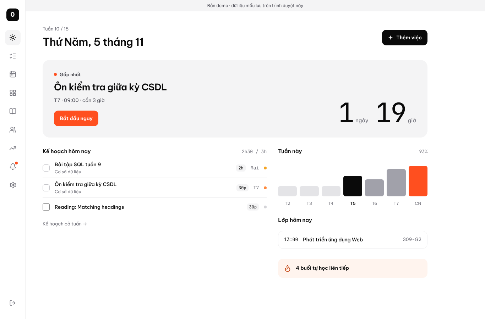
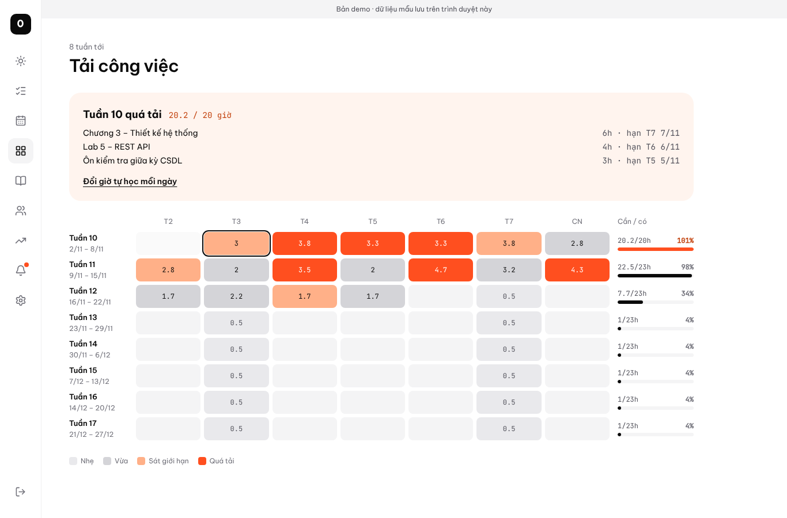
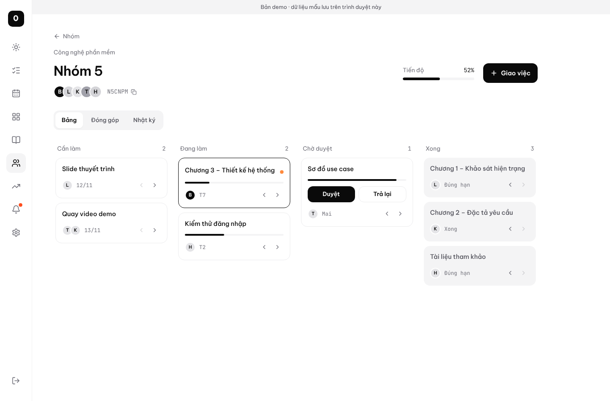
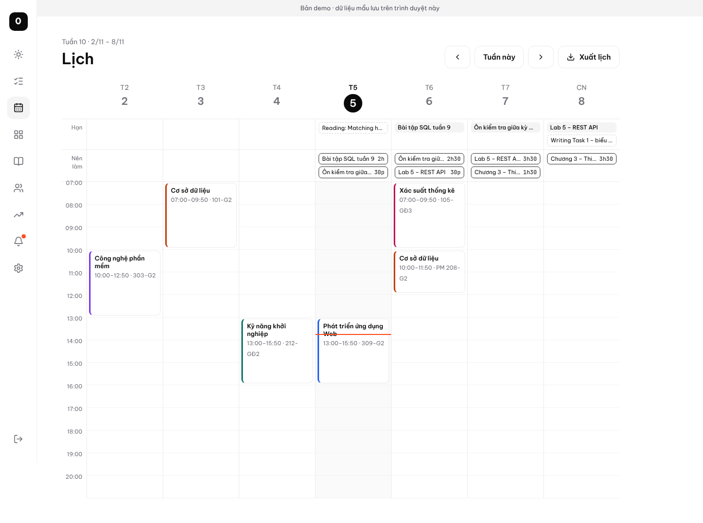
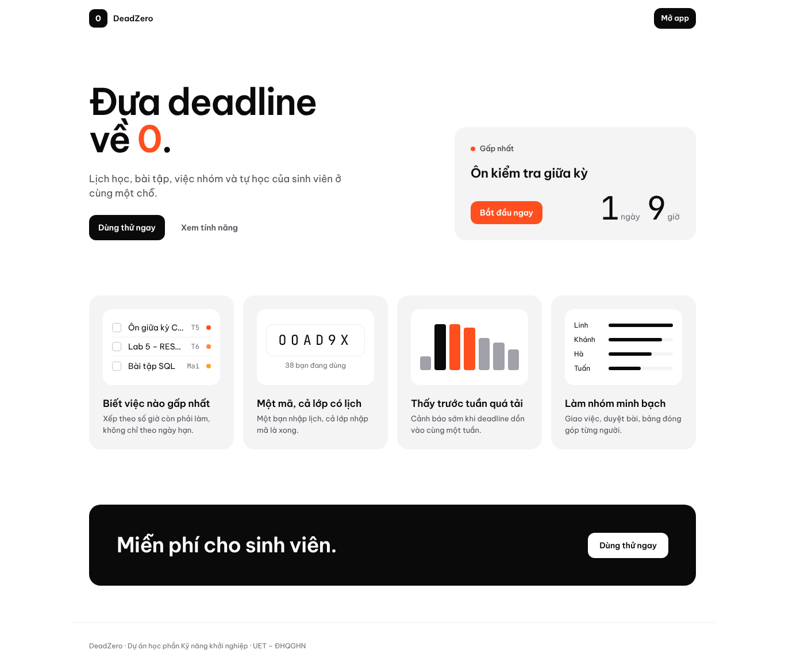

<div align="center">


# DeadZero

**Đưa deadline về 0.**

Lịch học, bài tập, việc nhóm và tự học của sinh viên ở cùng một chỗ.


</div>



## Vấn đề

Sinh viên đang quản lý việc học bằng 3–5 công cụ rời rạc: sổ tay, Google Calendar, Zalo, Trello, Notion. Deadline dễ trùng và bị quên, việc nhóm trôi theo tin nhắn, kế hoạch tự học dễ bỏ dở.

DeadZero gom tất cả vào một nơi, dùng chung một dòng thời gian, và cho biết **hôm nay nên làm gì, trong bao lâu**.

## Tính năng

| | |
|---|---|
| **Hôm nay** | Việc gấp nhất với đồng hồ đếm ngược, kế hoạch trong ngày đã chia sẵn số giờ, buổi học, buổi tự học |
| **Xếp ưu tiên thông minh** | Xếp theo số giờ còn phải làm so với giờ rảnh trước hạn, không chỉ theo ngày hạn. Tự tính *ngày nên bắt đầu* |
| **Gợi ý lịch làm** | Tự rải giờ làm vào giờ tự học còn trống mỗi ngày, việc hạn sớm được xếp trước |
| **Tải công việc** | Heatmap 8 tuần, cảnh báo sớm tuần quá tải và chỉ ra việc gây tải |
| **Lớp học phần dùng chung** | Một bạn nhập lịch, cả lớp nhập **mã 6 ký tự** là có lịch học, lịch thi, bài tập chung. Người tạo đổi phòng thì cả lớp được báo |
| **Dán thời khoá biểu** | Copy bảng TKB trên cổng đào tạo, dán vào là tạo xong các lớp |
| **Làm việc nhóm** | Kanban 4 cột có bước duyệt, giao việc, nhật ký không sửa được, bảng đóng góp từng người (xuất Excel) |
| **Lộ trình tự học** | Mẫu IELTS, Python, ôn thi cuối kỳ; tự chia thành buổi nhỏ, streak, dời buổi bị lỡ |
| **AI** | Dán đề bài → tự chia thành các bước kèm số giờ; tạo lộ trình tự học theo mục tiêu riêng |
| **Thống kê** | Giờ hoàn thành theo tuần, tỷ lệ đúng hạn theo tháng, theo môn |
| **Nhắc qua email** | Tóm tắt deadline gấp lúc 06:30 mỗi sáng |
| **Đồng bộ** | Xuất lịch sang Google Calendar (.ics), cài như app trên điện thoại (PWA), realtime giữa các thành viên |

<table>
  <tr>
    <td></td>
    <td></td>
  </tr>
  <tr>
    <td align="center"><sub>Tải công việc 8 tuần</sub></td>
    <td align="center"><sub>Workspace nhóm</sub></td>
  </tr>
  <tr>
    <td></td>
    <td></td>
  </tr>
  <tr>
    <td align="center"><sub>Lịch tuần và kế hoạch nên làm</sub></td>
    <td align="center"><sub>Trang giới thiệu</sub></td>
  </tr>
</table>

## Cách xếp ưu tiên

Mỗi việc chưa xong có **hệ số gấp r**:

```
r = giờ còn phải làm ÷ giờ tự học còn trống trước hạn
```

Giờ trống đã trừ phần dành cho các việc có hạn sớm hơn.

| r | Mức |
|---|---|
| ≥ 1 | 🔴 Nguy cơ trễ |
| 0,6 – 1 | 🟠 Cao |
| 0,3 – 0,6 | 🟡 Vừa |
| < 0,3 | ⚪ Thấp |

**Ngày nên bắt đầu** = ngày mà từ đó đến hạn vừa đủ giờ tự học, trừ 1 ngày dự phòng.
Ví dụ: cần 10 giờ, học 3 giờ/ngày, hạn 23:59 ngày 20/11 → làm 17–20/11 → nên bắt đầu **16/11**.

## Chạy trên máy

Cần Node.js 18 trở lên.

```bash
git clone https://github.com/dungvuColder/deadzero.git
cd deadzero
npm install
npm run dev          # http://localhost:5173
```

Không có file `.env` → app chạy **chế độ demo**: dữ liệu mẫu lưu trên trình duyệt, không cần tài khoản.

## Chế độ thật (nhiều người dùng)

### 1. Supabase

1. Tạo project tại [supabase.com](https://supabase.com) (region Singapore).
2. **SQL Editor → New query** → dán toàn bộ [`supabase/schema.sql`](supabase/schema.sql) → **Run**.
3. **Authentication → URL Configuration**: Site URL = link web; thêm `https://<link-web>/**` và `http://localhost:5173/**` vào Redirect URLs.
4. **Authentication → Emails**: ở 2 mẫu *Confirm signup* và *Magic Link*, thêm dòng `<p>Mã đăng nhập: <b>{{ .Token }}</b></p>` để người dùng nhập được mã 6 số (mail trường hay tự quét link làm link hết hạn).
5. **Settings → API Keys**: copy Project URL và Publishable key.

### 1b. AI chia nhỏ bài tập (tuỳ chọn)

1. Lấy API key miễn phí tại [Google AI Studio](https://aistudio.google.com/apikey).
2. Supabase → **Edge Functions → Secrets**: thêm `GEMINI_API_KEY` = key vừa lấy (tuỳ chọn `GEMINI_MODEL`, mặc định `gemini-3.5-flash-lite`).
3. Deploy hàm: `supabase functions deploy ai-breakdown` (mã nguồn trong `supabase/functions/ai-breakdown`).

### 1c. Nhắc deadline qua email (tuỳ chọn)

1. Tạo tài khoản [Brevo](https://www.brevo.com) (miễn phí 300 email/ngày), xác minh một địa chỉ gửi tại **Senders**, tạo API key tại **SMTP & API**.
2. Supabase → **SQL Editor**, chạy (thay giá trị của bạn):
   ```sql
   select vault.create_secret('xkeysib-...', 'brevo_api_key');
   select vault.create_secret('email-da-xac-minh@gmail.com', 'digest_sender');
   ```
3. Chạy [`supabase/email_digest.sql`](supabase/email_digest.sql). Mỗi sáng 06:30 hệ thống gửi tóm tắt cho người có việc gấp. Trong app: **Cài đặt → Gửi thử cho tôi**.

### 2. Biến môi trường

Tạo file `.env` (xem `.env.example`):

```env
VITE_SUPABASE_URL=https://xxxx.supabase.co
VITE_SUPABASE_ANON_KEY=sb_publishable_...
```

Hai giá trị này được phép công khai; dữ liệu được bảo vệ bằng Row Level Security. **Không** dùng Secret key ở đây.

### 3. Deploy lên Vercel

1. [vercel.com](https://vercel.com) → **Add New → Project** → chọn repo này (Vercel tự nhận Vite).
2. **Settings → Environment Variables**: thêm 2 biến trên, loại *Config* (không phải Secret).
3. **Deploy**. Mỗi lần push lên nhánh mặc định, Vercel tự deploy lại.

> Gói miễn phí của Supabase tạm dừng project sau 7 ngày không có hoạt động. Mở web hoặc Dashboard 1–2 ngày trước buổi demo.

## Kiến trúc

```
Trình duyệt (React SPA, PWA)
   │  supabase-js: REST + Realtime
   ▼
Supabase
   ├── Auth           đăng nhập bằng link email / Google
   ├── PostgreSQL     12 bảng + Row Level Security
   ├── RPC            my_state, join_class, join_group, add_class_task, …
   ├── Trigger        tạo thông báo khi giao việc, đổi lịch, chờ duyệt
   └── Realtime       tasks, nhật ký, lịch lớp, thông báo
```

Mọi thao tác ghi dữ liệu đi qua interface `Repo` (`src/lib/types.ts`), có 2 bản cài đặt: `localRepo` (demo, localStorage) và `supabaseRepo` (thật). Giao diện không cần biết đang chạy chế độ nào.

## Cấu trúc thư mục

```
src/
├── lib/
│   ├── priority.ts     hệ số gấp r, ngày nên bắt đầu, tải công việc
│   ├── planner.ts      gợi ý lịch làm (Earliest Deadline First)
│   ├── templates.ts    lộ trình tự học, streak, dời buổi lỡ
│   ├── parseTkb.ts     đọc thời khoá biểu dán từ cổng đào tạo
│   ├── exporters.ts    xuất .ics và CSV
│   └── seed.ts         dữ liệu mẫu cho chế độ demo
├── data/
│   ├── store.tsx       state chung, chọn chế độ demo / Supabase
│   ├── localRepo.ts    chế độ demo
│   └── supabaseRepo.ts chế độ thật
├── components/         Shell (điều hướng), ui, tasks
└── pages/              Hôm nay, Nhiệm vụ, Lịch, Tải, Lớp, Nhóm, Tự học, …
supabase/schema.sql     bảng, phân quyền, hàm RPC, trigger, realtime
```

## Lộ trình

- [x] Lớp học phần dùng chung bằng mã, dán thời khoá biểu
- [x] Xếp ưu tiên, ngày nên bắt đầu, tải công việc, gợi ý lịch làm
- [x] Workspace nhóm: Kanban, duyệt việc, nhật ký, bảng đóng góp
- [x] Lộ trình tự học, xuất Google Calendar, PWA
- [x] AI chia nhỏ bài tập và tạo lộ trình tự học (Gemini)
- [x] Email tóm tắt deadline mỗi sáng (Brevo)
- [x] Thống kê học tập
- [ ] Thông báo đẩy trên điện thoại
- [ ] Bình luận, @nhắc tên, đính kèm file trong việc nhóm
- [ ] Sửa, xoá lớp; quản lý thành viên nhóm
- [ ] Thông báo qua Zalo OA
- [ ] Kết nối trực tiếp cổng đào tạo (khi hợp tác với nhà trường)

---

<sub>Dự án học phần Kỹ năng khởi nghiệp · Trường Đại học Công nghệ – ĐHQGHN</sub>
